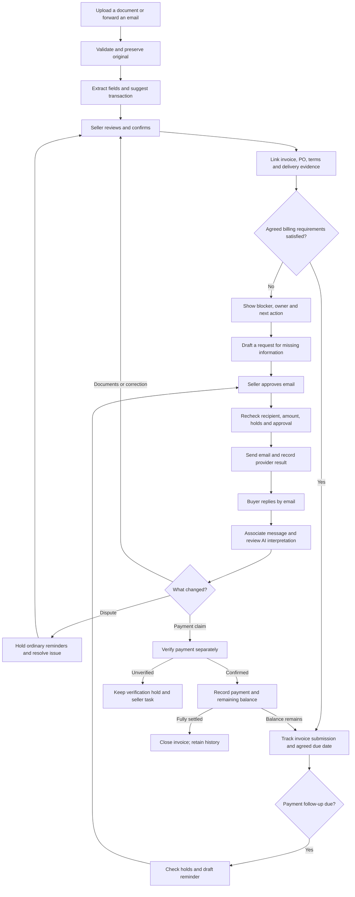

# NudgeWise email proof-of-concept plan

## Primary goal

An SME seller can bring an invoice and its supporting documents into NudgeWise, understand what is blocking payment, and approve the right email follow-up. Buyers can reply by ordinary email without creating an account; the seller remains responsible for confirming agreements, disputes, and payments.

Planning date: 22 October 2026. This is a proposed implementation, not a description of completed features. No application code, dependencies, credentials, or running services were changed to produce this plan.

## Product boundary

Start with one SME selling physical goods to business buyers, using synthetic records. Prove one connected workflow: buyer PO -> seller invoice -> delivery evidence -> missing requirement or dispute -> reviewed email -> buyer reply -> seller resolution -> verified payment record.

NudgeWise is the seller's invoice and payment-blocker workspace. It does not replace the buyer's procurement system, an accounting ledger, a courier system, a bank, or a card-dispute adjudicator.

The buyer normally issues the PO; the seller normally issues the invoice and delivery order. A signed delivery order, carrier confirmation, or buyer acknowledgment can supply evidence of delivery, but does not automatically establish acceptance, correct quantity, or payment eligibility. The recorded agreement controls those decisions.

## Current project and reuse

- `README.md`: invoice follow-up prototype with synthetic data; optional Telegram receipt integration; production authentication and real bank verification absent.
- `package.json`: Vue 3, TypeScript, Vite 5, Vue Router, Tailwind, Chart.js; Node >=24; existing logic and Telegram test commands.
- `src/types.ts`: customer already has an email; invoice status currently means paid/pending/overdue, with separate dispute and verification flags.
- `src/services/commands.ts:8`, `:20`, `:34`, and `src/App.vue:17`: Telegram currently gates backend commands, refresh, and polling. Separate backend availability from channel choice before removing Telegram. Preserve `src/composables/useDemoStore.ts` persistence behavior.
- `src/lib/reminderEngine.ts:168` and `src/lib/actions.ts:57`: current reminder recipients use phone numbers even though customer email already exists. Change recipient validation and approval fingerprints together.
- `src/lib/reminderEngine.ts`, `actions.ts`, `attention.ts`, `replyAnalysis.ts`, `priorityEngine.ts`: reuse reminder holds, approval/revalidation, attention queue, reply interpretation, and priorities.
- `src/lib/receipts.ts`: existing matching relies on Telegram chat and message identities; extraction is for transfer receipts, not general PO/invoice intake.
- `server/app.cjs`, `server/integrations.cjs`, `server/access.cjs`: reuse HTTP routes, SQLite persistence, access checks, bounded extraction, and AI validation where applicable.
- `server/app.cjs:142`: an exact synthetic receipt match currently records settlement automatically. Replace this with pending verification in the new workflow.
- `server/access.cjs:8` and `server/app.cjs:239`: existing shared demo passcode/cookie and host/origin checks are useful demo controls, but do not establish individual user or tenant authentication. Provider webhooks need an independently verified route.
- `server/ocr.py`: existing PDF/image OCR is bounded to five pages and 10 MiB, with a 30,000-character output limit. Table structure extraction is currently disabled; realistic PO line-item extraction must be proved with fixtures before claiming support.

## Recommended stack

| Layer | Choice | Reason |
|---|---|---|
| Seller interface | Existing Vue 3 + TypeScript + Vite + Tailwind | Keep the current views, drawer, approvals, and attention queue. |
| Backend | Existing Node 24 HTTP service | Add the few intake/email routes needed; no framework rewrite. |
| Structured records | Existing SQLite, with explicit schema migrations | Sufficient for one demo business on one backend instance. Preserve existing records. |
| Original documents | Private files on the backend's persistent disk; metadata in SQLite | Keep originals out of public static assets and browser storage. Production object storage is a later deployment decision. |
| Extraction | Existing Python Docling/RapidOCR worker | Reuse OCR; add schemas per document type rather than reusing the receipt schema for everything. |
| AI | Existing Ollama cloud/Gemma integration | Extract proposed fields, classify buyer replies, summarize evidence, draft emails. Confirm model availability during implementation. |
| Email | Resend sending + receiving, subject to documented capability/setup checks | One provider for both directions, with inbound webhook and attachment retrieval. No mailbox-wide Gmail permissions for this POC. |
| Background work | Persist pending intake/send jobs in SQLite and run them in the existing Node service | Survive restarts; separate a durable webhook receipt from slow OCR/AI work. No Redis or separate queue service initially. |
| Demo operation | Local seller UI and backend; public HTTPS ingress only for the signed webhook route | Prove live replies without exposing the unauthenticated seller API. A hosted deployment needs an authenticated seller boundary and persistent disk. |

No new database service, frontend framework, AI platform, or generic messaging abstraction is needed. Use the provider's documented SDK or HTTP API; use its supported verification library rather than implementing webhook cryptography manually.

## How documents enter the system

### Route A: seller upload — required first

1. Seller chooses Add invoice / Add supporting document.
2. Seller uploads an existing PDF, JPG, or PNG, or enters invoice details manually when no file exists.
3. The backend validates the file and stores the original privately with its source and upload time.
4. OCR and AI propose a document type and structured fields.
5. Seller checks the original beside the proposed values, corrects them, and confirms the customer and invoice link.
6. Only confirmed fields influence billing readiness, due dates, and reminder decisions.

Uploading an invoice imports an already issued document. It does not issue a statutory e-invoice or create an accounting-system invoice. Manual entry creates a tracking record, which must be labeled accordingly.

### Route B: forward an email — required for the complete email POC

1. Buyer emails a PO to the seller's normal address.
2. Seller forwards that message and its attachment to the configured NudgeWise receiving address.
3. The email provider delivers a signed notification to the backend.
4. Backend verifies the notification, persists its identity, and schedules retrieval/processing.
5. Backend retrieves the email content and attachments through the provider's documented APIs, stores the originals, and runs the same review flow as upload.

Users do not have to upload every file manually. They can upload or forward. Direct receipt from buyers is also possible once the address is shared and the transaction/customer association is confirmed. NudgeWise cannot access a seller's old inbox or documents automatically without a separately implemented integration and permission.

An email forward is not proof that the apparent original author approved anything. Preserve the forwarding sender and original-message information separately; keep uncertain identity or associations in review.

### Route C: reply to an invoice email

1. Seller approves an invoice-related email sent by NudgeWise.
2. Its reply address routes replies to the receiving domain and carries an opaque transaction reference.
3. Buyer replies with text and possibly a signed delivery order, complaint, or payment receipt.
4. NudgeWise uses the receiving address reference and stored message-thread identifiers to suggest the transaction; ambiguous matches require seller confirmation.
5. AI proposes a reply category and next action. A credible dispute or payment claim creates a review hold; resolving it, changing agreed terms, refunding, or confirming payment requires seller action.

The buyer needs only email. A familiar sender address is not authentication or authority to change payment details. External email text and attachments are untrusted data, including instructions embedded in documents.

## Main seller flow

## Minimum system contents

| Existing area | Proposed change |
|---|---|
| Dashboard | Retain outstanding/overdue totals; add blocked amount and reasons. Keep disputed, not-yet-due, and overdue amounts distinguishable. |
| Invoices | Add document intake and a detail section for source documents, agreed terms, requirements, and submission evidence. |
| Action Center | Reuse one queue for extraction review, missing PO, delivery discrepancy, dispute, payment verification, and email approval/failure. |
| Customers | Maintain billing email, finance contact, and default requirements. Copy defaults into an explicitly confirmed transaction agreement. |
| Invoice activity | Show document provenance, confirmed changes, emails, replies, dispute decisions, and payments in time order. |
| AI assistant | Explain the specific blocker and draft the next request with source links. Unknown facts remain unknown. |

Avoid a separate screen for each document type. Reuse the invoice drawer and Action Center; one intake/review view is enough.

## Business rules to implement

1. PO is optional unless the recorded transaction agreement requires it. The app requests/imports a buyer PO; it does not manufacture buyer approval.
2. Record the confirmed agreement and its source. Customer defaults are suggestions for new transactions, not retroactive changes. Conflicts between buyer and seller terms create a review task.
3. Separate billing readiness, payment status, and blocker/review state. A missing PO is not a payment status. A blocked invoice can still have an overdue recorded balance.
4. Support a small fixed set of requirements: PO reference required, delivery/acceptance evidence required, and a confirmed payment-due basis. Record deposits/prepayments explicitly; never require delivery for every invoice.
5. Treat invoice submitted, email delivered, buyer acknowledged, and invoice accepted as different events. Provider delivery alone does not establish contractual invoice acceptance or when a payment clock starts.
6. Compare confirmed PO/invoice/delivery values. Flag mismatched references, amounts, or quantities. Do not silently alter an issued invoice or invent line-item matches.
7. For a line-item demonstration, support one PO, one invoice, and one delivery document per transaction. Additional or ambiguous documents require manual review rather than automatic allocation; upgrade for consolidated billing or split deliveries when validated demand exists.
8. A missing document gets a document-request draft, not an overdue-demand draft. Drafts require seller approval and send-time revalidation.
9. Record dispute reason, disputed amount, owner, evidence, and next action. Initially hold all ordinary collection emails on the affected invoice; allow a reviewed seller message where appropriate. Do not automate collection of an undisputed portion until that rule is explicitly agreed and modeled.
10. A receipt establishes a payment claim, not bank settlement. Keep the claim under verification until a trusted payment source or explicit seller confirmation records payment. Preserve partial payments and avoid duplicate allocation.
11. An apparent promise or revised payment date is a proposal until seller confirmation. Preserve the original terms and change history.
12. AI drafts/extracts/classifies; deterministic code checks balances, dates, required fields, holds, and approval freshness. AI does not decide legal entitlement, accept a disputed delivery, or authorize refunds.

## Minimum data additions

Extend existing types/tables; use established money and date conventions. Do not add a generic enterprise workflow engine.

- **Document:** business, type (invoice/PO/delivery/receipt/other), private storage key, filename, content type, hash, source (upload/email), source message, extraction state, proposed fields, confirmed fields, reviewer, review time. Store field provenance where shown to the seller.
- **Transaction/links:** connect customer, invoice, PO, delivery evidence, and other documents. Start with explicit reviewed links; preserve ambiguous candidates outside the confirmed record.
- **Agreed requirements:** PO requirement, delivery/acceptance requirement, payment-term trigger, confirmed due date/basis, source document, confirmer, confirmation time. Snapshot changes so later defaults do not rewrite history.
- **Blocker/task:** invoice, reason, owner, opened/resolved times, next action, supporting documents. Reuse existing attention/action records when they can express this without duplicate sources of truth.
- **Email message:** business/customer/invoice association, provider event/email IDs, Message-ID and thread headers, recipient/reply address, text, attachment links, direction, submission/delivery/failure state, timestamps, review result.
- **Dispute detail:** extend existing dispute flag with reason, amount, evidence links, owner, next action, and resolution. Existing payment records continue to hold actual payments.
- **Durable job:** existing SQLite work item or minimal table for pending intake/send, attempt count, next attempt, provider idempotency key, result, and error. Enforce event/message deduplication.

Do not reset localStorage/SQLite to introduce fields. Back up first, migrate explicitly, and preserve prior activity. Existing synthetic Telegram records may remain readable as legacy history without an active Telegram integration.

## Phase 0: Documentation discovery

**How this serves the primary goal:** Verify the existing reuse points and email capabilities before committing implementation to an assumed interface.

What to do: inspect the project paths above; confirm provider sending/receiving prerequisites, webhook verification, message retrieval, attachment retrieval, threading, retries, and idempotency in current official docs. One Context7 connector failed due to its configured key; the alternate connector succeeded, resolving `/websites/resend` and retrieving current documentation. Official provider pages were also checked to resolve an inconsistent example. Recheck against the installed SDK during implementation.

Documentation references: `README.md`, `package.json`, `server/README.md`, source/test paths listed above; official provider references below.

Verification: confirm a permitted sending domain/address, receiving address, signed HTTPS ingress, and an available extraction model. Establish which setup is local demo versus deployed service.

Anti-pattern guards: an email-received notification is not assumed to contain the full body/attachment bytes; do not assume sending permission from receiving-domain setup; do not assume PO support from receipt extraction.

## Phase 1: Replace Telegram coupling with email-ready backend access

**How this serves the primary goal:** Keep the functioning invoice workflow available after removing Telegram.

What to implement: preserve the current command/API structure while removing Telegram's control over server-backed storage, AI, and receipt processing. Require valid customer billing addresses for live sending. Replace Telegram UI labels/previews/configuration with email-specific controls; preserve approvals and send-time checks. Remove polling, bot send/download/chat-link routes, active bot configuration, and obsolete Telegram dependencies/fixtures only after replacement coverage exists.

Documentation references: `src/services/commands.ts`, `src/composables/useDemoStore.ts`, `server/app.cjs`, `server/integrations.cjs`, `src/components/MessagePreview.vue`, and `server/README.md`.

Verification: server mode works without a bot token; dashboard and approvals still load; browser-only demo behavior is explicitly supported or clearly disabled; logic tests remain green. No active flow asks for a Telegram chat ID.

Anti-pattern guards: do not just set the old Telegram flag to false; do not wipe history; do not introduce a generic multi-channel framework when only email is required.

## Phase 2: Add upload and document review

**How this serves the primary goal:** Give the seller a reliable way to bring real source records into the workflow before automating email intake.

What to implement: bounded upload; private original storage; type-specific extraction; review beside original; confirmed invoice/customer association; persisted links and provenance. Reuse the OCR worker and existing AI schema validation pattern. Add the minimal schema migrations and backup instructions.

Documentation references: `server/ocr.py`, `server/integrations.cjs`, `src/lib/receipts.ts`, `src/types.ts`, `src/views/InvoicesView.vue`, `src/components/InvoiceDetailDrawer.vue`.

Verification: synthetic invoice, PO, delivery proof, and receipt fixtures each extract into their own schema; malformed/oversize/unsupported files fail safely; low-confidence/ambiguous associations remain in review; duplicates do not create duplicate obligations; originals survive restart. Re-uploaded identical evidence may link to an existing file without discarding provenance.

Anti-pattern guards: validate actual content type and size; use generated storage names; do not expose filesystem paths or public file URLs; do not interpret embedded document instructions as application commands.

## Phase 3: Add business requirements and payment blockers

**How this serves the primary goal:** Explain why payment cannot progress and choose a useful action instead of sending an inappropriate reminder.

What to implement: the fixed requirements and confirmed term basis above; document comparisons; blocker/task ownership; dispute detail; separate billing/payment/review state. Extend existing holds and attention logic rather than replacing them. Require seller confirmation before due-date changes, acceptance, dispute resolution, or payment recording.

Documentation references: `src/lib/reminderEngine.ts`, `actions.ts`, `attention.ts`, `store.ts`, `src/types.ts`, and `tests/logic.test.cjs`.

Verification: missing PO blocks only transactions requiring a PO; delivery is not required for an agreed deposit; missing acceptance produces the correct task; quantity mismatch goes to review; dispute/verification holds stop ordinary reminders; a blocked invoice is not silently removed from outstanding totals; payment claims do not settle balances.

Anti-pattern guards: do not treat a company policy as a confirmed agreement; do not infer acceptance from a delivery scan; do not change an issued invoice automatically.

## Phase 4: Send and receive email

**How this serves the primary goal:** Let sellers and buyers complete the workflow through normal email with traceable messages and attachments.

What to implement: reviewed email drafts and live sends; opaque reply routing and persisted thread IDs; signed inbound webhook with durable receipt before success acknowledgment; provider email/attachment retrieval; the same extraction review queue as upload; delivery/failure events; restart-safe retries and deduplication. Retry uncertain sends only with the same provider idempotency key within its documented window; after that, reconcile the outcome or require manual review before any new send. Retain ambiguous or unfamiliar senders for review rather than dropping or auto-trusting them.

Documentation references: official email references below; reuse the existing approval/revalidation structure and integration test patterns in `tests/telegram.test.cjs` and `tests/ollama.test.cjs`.

Verification: approved email reaches a controlled buyer inbox; reply and attachment reach the correct queue; duplicate/reordered webhooks do not create repeated processing or regress delivery state; invalid signature is rejected; backend restart recovers queued work; send timeout does not cause duplicate mail; changed invoice/recipient invalidates stale approval. A bounce creates a seller task. Delivered email is not labeled accepted or paid.

Anti-pattern guards: no send from the browser; no client-side secrets; no sender-name-only matching; no raw HTML email rendering; no webhook exposure of the unauthenticated seller API; no external email sends in automated tests.

## Phase 5: Verify the end-to-end proof of concept

**How this serves the primary goal:** Demonstrate that the system reduces document chasing and incorrect follow-ups through a complete transaction.

What to do: add meaningful synthetic fixtures and email-provider mocks, update affected scripts/config/docs, then run the existing typecheck, frontend build, logic tests, and relevant server/AI tests. Add email tests to replace Telegram-specific coverage while preserving shared assertions. Use one explicitly approved live email round trip for the demo.

Documentation references: `package.json`, `tests/logic.test.cjs`, `tests/telegram.test.cjs`, `tests/ollama.test.cjs`, `.env.example`, `README.md`, `server/README.md`, `replit.md`, and applicable submission material.

Verification scenario: import a 100-unit buyer PO and invoice; attach evidence showing only 80 units accepted; flag the discrepancy; approve an explanatory email; receive the buyer's reply; seller records the agreed correction or remaining delivery; confirm billing requirements; prepare the appropriate follow-up; receive a receipt; verify separately; record payment and stop further reminders when fully settled.

Anti-pattern guards: grep for active Telegram flags, bot token requirements, chat matching, UI labels, and scripts; distinguish legacy history from active integration. Do not claim successful payment settlement, contractual acceptance, statutory e-invoicing, or bank verification from this demo.

## Proof-of-concept acceptance criteria

- Seller can upload or forward source documents and review extracted values.
- Buyer can reply to a NudgeWise email without an account.
- Every invoice shows its supporting evidence, current blocker, owner, and next action.
- Missing requirements change the draft's purpose; disputed/unverified invoices do not receive ordinary collection reminders.
- No extraction, forwarded email, receipt, or provider delivery event silently confirms an agreement or settles a payment.
- Original files, confirmed changes, messages, and decisions remain traceable after restart.
- Failure, duplicate, ambiguous, and partial-payment paths are demonstrated, not only the happy path.

## Not in this proof of concept

Full procurement/PO issuance, inventory, courier integrations, multi-party portals, Gmail/Outlook inbox sync, automatic bank reconciliation, Stripe chargeback submission, legal dispute decisions, statutory e-invoice submission, general accounting, consolidated billing, and complex split-delivery allocation.

No production authentication or tenant-isolation claim is made. Use synthetic data in the current demo; real business use requires authenticated access, private evidence access controls, backups, and a reviewed data-handling arrangement for email and cloud AI.

## Official email references

These are implementation references verified through Context7 and official documentation. No provider account was configured and no messages were sent while creating this plan.

| Topic | Verified behavior and copy-ready section |
|---|---|
| Receiving address | [Receiving introduction](https://resend.com/docs/dashboard/receiving/introduction): managed `<id>.resend.app` receiving subdomain, or a configured custom receiving domain. Use a separate receiving address per transaction via opaque recipient references. |
| Sending prerequisites | [Test-domain restriction](https://resend.com/docs/knowledge-base/403-error-resend-dev-domain): the default sender can send only to the account owner's email. Sending to a separate buyer requires a verified sending domain. [Domain setup](https://resend.com/docs/dashboard/domains/introduction): copy provider-generated DNS records. |
| Receiving DNS | [Custom domains](https://resend.com/docs/dashboard/receiving/custom-domains): a custom receiving domain needs its receiving MX record. Use a dedicated subdomain to avoid rerouting an existing company inbox. |
| HTTPS ingress | [Webhook introduction](https://resend.com/docs/webhooks/introduction): the provider sends HTTPS POST events; a local-only URL is insufficient. |
| Attachment retrieval | [Process attachments](https://resend.com/docs/dashboard/receiving/attachments): webhook attachment metadata does not contain the file bytes; API download URLs expire after one hour and can be refreshed. Validate and store originals rather than saving expiring URLs as the evidence record. |
| Webhook authenticity | [Verify webhooks](https://resend.com/docs/webhooks/verify-webhooks-requests): verify the unchanged raw request body and `svix-id`, `svix-timestamp`, `svix-signature` headers. The current SDK example uses `webhookSecret`, not `secret`. |
| Provider retries | [Retries and replays](https://resend.com/docs/webhooks/retries-and-replays): failed webhook deliveries retry. Deduplicate both the event identity and inbound email identity. |
| Send idempotency | [Idempotency keys](https://resend.com/docs/dashboard/emails/idempotency-keys): provider keys last 24 hours; keep NudgeWise's unique approved-send identity longer and do not blindly resend an uncertain outcome after expiry. |
| Email threading | [Reply to emails](https://resend.com/docs/dashboard/receiving/reply-to-emails): store RFC message IDs separately from provider IDs; use `In-Reply-To` and `References` for thread continuity. |

Allowed SDK APIs to copy from these examples, checking installed-version types before use:

- `new Resend(apiKey)`.
- `resend.emails.send({ from, to, replyTo, subject, text }, { idempotencyKey })`.
- `resend.webhooks.verify({ payload: rawBody, headers: { id, timestamp, signature }, webhookSecret })`.
- On `email.received`, `resend.emails.receiving.get(event.data.email_id)`.
- `resend.emails.receiving.attachments.list({ emailId: event.data.email_id })`.

Do not implement APIs from guesswork. Handle the SDK's returned `error` as well as thrown failures. Actual provider quotas/prices, account setup, sending-domain ownership, DNS, installed SDK version, webhook reachability, model availability, and inbox deliverability remain untested.
