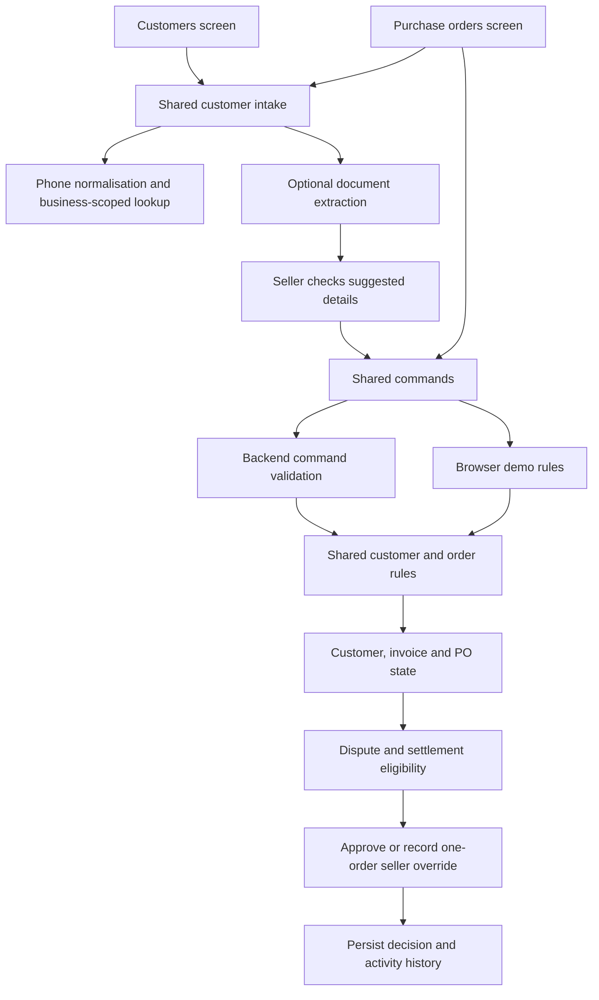

# NudgeWise project map

Start here when changing a workflow. Keep business decisions in the shared rule modules so browser mode and the backend apply the same checks.

## Find the right place

| Task | Start here | Follow through |
| --- | --- | --- |
| Find or create a customer by phone | [CustomerIntake.vue](../src/components/CustomerIntake.vue) | [customerOrders.ts](../src/lib/customerOrders.ts): `normalizePhone`, `lookupCustomersByPhone`, `createCustomer` |
| Review customer history | [CustomersView.vue](../src/views/CustomersView.vue) | [priorityEngine.ts](../src/lib/priorityEngine.ts); priority colours are separate from order eligibility |
| Receive a buyer PO, check holds, approve or override | [OrdersView.vue](../src/views/OrdersView.vue) | [customerOrders.ts](../src/lib/customerOrders.ts): `getOrderEligibility`, `createPurchaseOrder`, `approvePurchaseOrder` |
| Read a customer document | [commands.ts](../src/services/commands.ts): `extractCustomerDocument` | [app.cjs](../server/app.cjs): `/api/customer-document` → [integrations.cjs](../server/integrations.cjs): `extractCustomer` → [ocr.py](../server/ocr.py) |
| Change invoice/dispute/payment behaviour | [actions.ts](../src/lib/actions.ts) | [store.ts](../src/lib/store.ts), [types.ts](../src/types.ts), [customerOrders.ts](../src/lib/customerOrders.ts) |
| Change reminder eligibility or approval | [reminderEngine.ts](../src/lib/reminderEngine.ts) | [actions.ts](../src/lib/actions.ts), [ActionCenterView.vue](../src/views/ActionCenterView.vue) |
| Explain why something needs attention | [attention.ts](../src/lib/attention.ts) | [AttentionQueue.vue](../src/components/AttentionQueue.vue), [display.ts](../src/presentation/display.ts) |
| Change frontend/backend communication | [commands.ts](../src/services/commands.ts) | [app.cjs](../server/app.cjs); keep command allowlists and validation aligned |
| Change persistence or old-record upgrades | [store.ts](../src/lib/store.ts) | [app.cjs](../server/app.cjs): SQLite storage adapter |
| Add navigation | [router/index.ts](../src/router/index.ts) | [AppSidebar.vue](../src/components/AppSidebar.vue) |
| Understand the planned email/document workflow | [email-mvp-plan.md](email-mvp-plan.md) | This is a proposal, not proof that email sending, PO evidence matching or delivery tracking is implemented |

## How the customer/order feature connects



A PO record represents an incoming buyer order reference. Approving it means the seller allows processing. It does not issue a buyer PO, create an invoice or prove delivery.

The authoritative order check runs again at approval. A resolved dispute can still require settlement; an override records the seller, reason and blocking invoices for one order without clearing old invoices. Phone lookup helps find records but does not authenticate the buyer.

## Checks near the feature

PO document entry starts in [PurchaseOrderForm.vue](../src/components/PurchaseOrderForm.vue), with validation and totals in [purchaseOrder.ts](../src/lib/purchaseOrder.ts). The backend stores original bytes in SQLite `po_evidence`; uploads and OCR failures are covered by [purchase-order.test.cjs](../tests/purchase-order.test.cjs). Fresh application state is empty; synthetic data is test-only. See the [current workflow walkthrough](customer-order-workflow.md).

- [customer-orders.test.cjs](../tests/customer-orders.test.cjs): phone lookup, dispute/settlement rules, order approval, migration and override behaviour; [logic.test.cjs](../tests/logic.test.cjs) retains the existing invoice checks.
- [customer-orders-server.test.cjs](../tests/customer-orders-server.test.cjs): backend command boundaries and customer-document extraction.
- [presentation.test.cjs](../tests/presentation.test.cjs): presentation regressions.
- [package.json](../package.json): authoritative scripts for typechecking, building and running tests. Follow the current scripts rather than copied command lists when they change.

## Interactive Graphify map

Open [graph.html](../graphify-out/graph.html) in a browser to search symbols and inspect their connections. [GRAPH_REPORT.md](../graphify-out/GRAPH_REPORT.md) lists community hubs and integrity findings; [graph.json](../graphify-out/graph.json) contains the underlying graph.

Useful starting symbols: `lookupCustomersByPhone`, `getOrderEligibility`, `approvePurchaseOrder`, `getStore`, `recordPayment`, `resolveDispute`, `createBackend`.

With Graphify installed, run from the repository root:

```powershell
graphify query "What connects customer intake to purchase order approval?"
graphify explain "getOrderEligibility"
```

To regenerate the same scoped map, use a Python interpreter with `graphifyy` installed:

```powershell
python graphify-out/rebuild.py
```

The interpreter used for the current build is recorded locally in `graphify-out/.graphify_python`. It is machine-specific; do not assume that path exists on another computer. The rebuild script stops when the corpus exceeds its reviewed size or Graphify refuses a graph shrink, so inspect changed scope before replacing outputs.

## Map boundaries

The graph combines AST relationships with document headings and explicit source references. Document indexing is deliberately structural, not a complete semantic extraction. Email planning sections remain proposals. Vue templates and dynamic dispatch may have incomplete connections; the integrity report exposes unresolved endpoints and merged relationships. Use the source and tests to confirm important behaviour.

Excluded: `.env` files, runtime customer data, dependencies, generated builds, datasets, RunPod assets, submission material and binary fixtures/PDFs. No credentials or live customer database contents were used. SQL relationships require Graphify's optional `tree_sitter_sql` parser. CSS and other formats unsupported by the extractor may be absent. Generated map files are local artifacts, not a deployed application feature.
